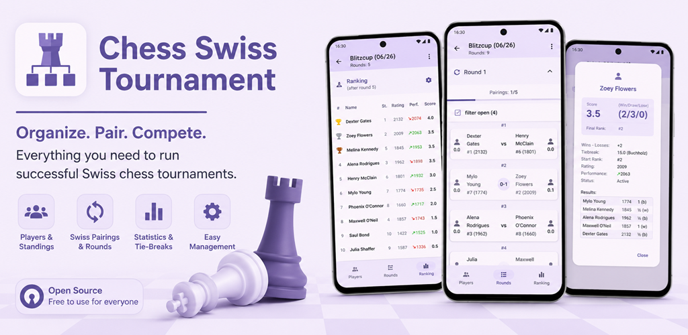

# Chess Swiss Tournament App

A tournament management app for Android for Swiss tournaments in chess.

## Getting Started

This project is a Flutter application written in Dart.

- Run `flutter run` to run the app.
- To regenerate bindings after changing Java code, run
  `dart run tool/jnigen.dart`. This requires at least one APK build to have
  been run before, so that  JNIgen can obtain classpaths of Android Gradle
  libraries. Therefore, run `flutter build apk` once before generating bindings
  for the first time, or after a `flutter clean`.

### Test

- Run `flutter test --coverage integration_tests` to run the tests.`
- Run `genhtml coverage/lcov.info -o coverage/html` to generate an HTML coverage report

### Build

- To generate the app build timestamp, run `dart run build_runner build --delete-conflicting-outputs`
- To run in release mode: `flutter run --release`
- To build release appbundle: `flutter build appbundle --release`

### TODOs:

- Datumsformatierung nach Locale
- Testabdeckung checken
- Testen: größere Schriftart vom device 
- minimum Players: 4
- minimum Rounds: 2
- Turniertyp Roundrobin
